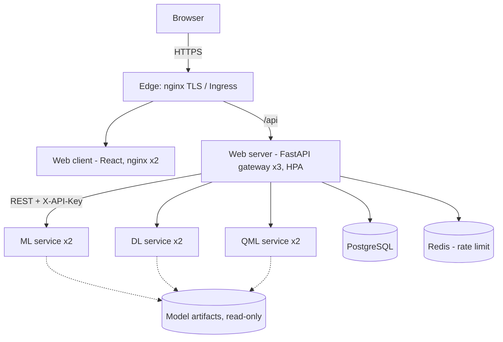

# Architecture (SAD v1.0)

| Tier | Components | Replicas on Kubernetes |
|---|---|---|
| Edge | nginx (TLS 1.2+, HTTP->HTTPS, HSTS) / Ingress | 1 (compose) / Ingress controller |
| 1 Web client | React SPA served by nginx | 2 |
| 2 Web server | `gateway/` FastAPI: auth, validation, orchestrator (scatter-gather, circuit breaker), history, admin, audit | 3 (HPA 3-8) |
| 3 Microservices | `services/ml_service`, `dl_service`, `qml_service` (X-API-Key, internal only) | 2 each |
| Data | PostgreSQL (users, predictions, audit), Redis (shared rate-limit counters) | 1 each |

Security: services and data stores are on the internal network only (compose `internal: true`; Kubernetes NetworkPolicies allow only client -> gateway -> services/data).
